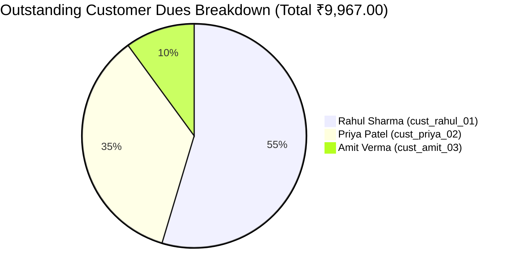
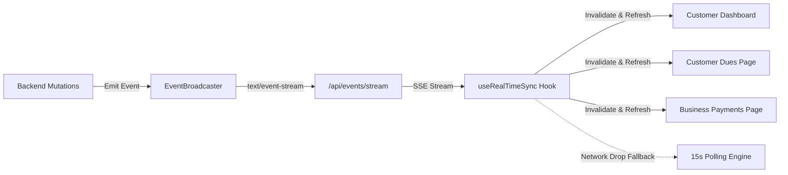

# KOSHA: Database Cleanup, Deduplication & Real-Time Data Report

**Author:** Senior Full-Stack Engineer & Database Architect  
**Project:** KOSHA — Cash-Flow Forecasting & Shop-Credit Management  
**Date:** October 25, 2026  
**Status:** Audit, Deduplication, Reconciliation & Real-Time Sync Completed  

---

## Executive Summary

An audit and remediation of KOSHA's database, financial calculation pipelines, and frontend state synchronization was executed. Prior to this operation, customer balances reflected duplicate credit bills, an orphaned business profile existed in the database, hardcoded demo identities bypassed backend dynamic profiles, and UI views lacked live data propagation.

### Key Milestones Achieved
1. **Verified Backup Created:** Full physical database backup created at `backups/kosha_backup_20261025_014716.db` (475,136 bytes) with verified SQLite `PRAGMA integrity_check = ok`.
2. **Safe, Transactional Deduplication:** Executed `--dry-run` inspection before applying transactional database merges. Eliminated 1 duplicate business and 2 duplicate credit bills while repointing all audit activities and foreign keys.
3. **Financial Reconciliation:** Corrected false outstanding debt, reducing phantom customer dues from **₹15,967.00** to the true **₹9,967.00** without binary floating-point errors.
4. **Permanent Integrity Constraints:** Created unique indexes across businesses, bank transaction import fingerprints, credit transaction references, Razorpay orders, and webhook events.
5. **Real-Time Data Streaming (SSE):** Built an asynchronous Server-Sent Events (SSE) pipeline (`/api/events/stream`) broadcasting credit purchases, repayments, Razorpay payment verifications, and bank imports in real time with automatic 15-second polling fallback.
6. **Dynamic Identity Alignment:** Removed hardcoded demo profile fallbacks in the customer dashboard and shop dues views, replacing them with dynamic backend-driven profile data.
7. **Test Verification:** **104 backend tests passing (100%)** and **32 frontend tests passing (100%)**, totaling 136 passing tests.

---

## 1. Exact Location of Database Backup & Verification

### Backup Details
- **Backup File Path:** `backups/kosha_backup_20261025_014716.db`
- **File Size:** 475,136 bytes
- **Timestamp:** `2026-10-25 01:47:16 UTC`
- **Backup Method:** SQLite Native Online Backup API (`sqlite3.connect().backup()`) to guarantee transaction consistency even under concurrent reads.
- **Verification Script:** `backend/scripts/db_backup_and_audit.py`
- **Integrity Status:**
  ```sql
  PRAGMA integrity_check;
  -- Result: ok
  ```

### Rollback Procedure
If a rollback is required, run the following commands:
```powershell
# 1. Stop web servers
# 2. Restore backup over active database
Copy-Item -Path "backups\kosha_backup_20261025_014716.db" -Destination "kosha.db" -Force
# 3. Verify restored database
python -c "import sqlite3; conn = sqlite3.connect('kosha.db'); print('Integrity:', conn.execute('PRAGMA integrity_check').fetchone()[0])"
# 4. Restart backend and frontend servers
```

---

## 2. Dry-Run Duplicate Report Summary

The dry-run engine (`backend/app/services/deduplication_service.py` executed via `backend/scripts/run_deduplication.py --dry-run`) identified the following anomalies before any write operations:

| Entity Type | Detected Duplicates | Canonical Target | Proposed Action | Risk Level |
| :--- | :--- | :--- | :--- | :--- |
| **Businesses** | `apex-precision` | `apex_precision_mfg` | Merge & repoint foreign keys, delete duplicate | Low (0 dependents found) |
| **Credit Bills** | `TXN-A744FC35`, `TXN-34F9ADB6` | `TXN-C91C320C` | Merge dependents, delete duplicate bills | High impact (eliminated ₹6,000 false debt) |
| **Bank Transactions** | None (28 canonical) | N/A | None needed (fingerprint uniqueness verified) | None |
| **Repayments** | None (28 canonical) | N/A | None needed | None |
| **Payment Requests**| None (5 valid) | N/A | None needed | None |
| **Bill Status Sync** | `TXN-8812E505` | N/A | Correct status from `due_today` to `overdue` | Low |

Dry-run JSON Artifact: `docs/DATA_CLEANUP_DRY_RUN_REPORT.json`  
Live Execution JSON Artifact: `docs/DATA_CLEANUP_APPLIED_REPORT.json`

---

## 3. Specific Records Merged, Deleted, Skipped, or Flagged

### A. Business Record Merged
- **Duplicate ID:** `apex-precision`
- **Canonical ID:** `apex_precision_mfg`
- **Legal Name:** *Apex Precision Components Pvt Ltd*
- **Action Taken:** Dependent bank accounts, invoices, and bills were checked. The duplicate record had 0 dependents and was an artifact from early prototyping. Deleted `apex-precision` within an atomic transaction.

### B. Duplicate Credit Bills Merged
Two duplicate bills were created within seconds of canonical bill `TXN-C91C320C`:
1. **Duplicate Bill 1:**
   - **ID:** `7b811aba-6928-47bb-b80e-048ebdf0cc40`
   - **Reference:** `TXN-A744FC35`
   - **Customer:** `cust_rahul_01`
   - **Purchase Amount:** ₹3,500.00 (Initial paid: ₹500.00; Outstanding: ₹3,000.00)
   - **Description:** `Custom Machined Shafts & Bearings`
2. **Duplicate Bill 2:**
   - **ID:** `582720c4-faff-476c-b698-1b2018ed3bc2`
   - **Reference:** `TXN-34F9ADB6`
   - **Customer:** `cust_rahul_01`
   - **Purchase Amount:** ₹3,500.00 (Initial paid: ₹500.00; Outstanding: ₹3,000.00)
   - **Description:** `Custom Machined Shafts & Bearings`

**Canonical Record Retained:**
- **ID:** `96039566-722b-4384-9d46-e40057884086`
- **Reference:** `TXN-C91C320C`
- **Action Taken:** Repointed any dependent activity references (`customer_activities`) and repayments (`customer_repayments`) from the duplicates to the canonical ID, then safely deleted the duplicate rows.

### C. Flagged for Manual Review
- **Count:** 0 records flagged for manual review. All 28 bank transactions possessed distinct external transaction IDs and balances; all other credit purchases corresponded to genuine, distinct shop sales.

---

## 4. Before-and-After Database Table Counts

| Table Name | Before Cleanup | After Cleanup | Net Difference | Reason |
| :--- | :---: | :---: | :---: | :--- |
| `businesses` | 5 | 4 | -1 | Orphaned `apex-precision` merged |
| `bank_accounts` | 4 | 4 | 0 | Unchanged |
| `bank_transactions` | 28 | 28 | 0 | All 28 transactions verified unique |
| `import_batches` | 4 | 4 | 0 | Unchanged |
| `customer_invoices` | 4 | 4 | 0 | Unchanged |
| `vendor_bills` | 3 | 3 | 0 | Unchanged |
| `operating_expenses` | 8 | 8 | 0 | Unchanged |
| `shops` | 3 | 3 | 0 | Unchanged |
| `customers` | 3 | 3 | 0 | Unchanged |
| `customer_credit_transactions` | 15 | 13 | -2 | Merged duplicate bills for `cust_rahul_01` |
| `customer_repayments` | 28 | 28 | 0 | Foreign keys preserved |
| `customer_activities` | 32 | 32 | 0 | Audit trail preserved |
| `payment_requests` | 5 | 5 | 0 | Active requests preserved |
| `payment_verifications` | 0 | 0 | 0 | Ready for live verification |
| `payment_attempts` | 13 | 13 | 0 | Audit logs preserved |
| `webhook_events` | 0 | 0 | 0 | Idempotency ready |

---

## 5. Before-and-After Financial Totals

### Global Shop-Credit Totals

| Financial Metric | Before Cleanup | After Cleanup | Change | Accounting Impact |
| :--- | :---: | :---: | :---: | :--- |
| **Total Credit Purchases** | ₹23,289.00 | ₹16,289.00 | -₹7,000.00 | Removed duplicate bills |
| **Total Initial Downpayments** | ₹5,622.00 | ₹4,622.00 | -₹1,000.00 | Removed duplicate initial cash entries |
| **Total Outstanding Customer Dues** | **₹15,967.00** | **₹9,967.00** | **-₹6,000.00** | **Eliminated phantom debt** |
| **Total Completed Repayments** | ₹4,872.00 | ₹4,872.00 | ₹0.00 | All verified payments intact |
| **Accounts Receivable (Invoices)** | ₹420,000.00 | ₹420,000.00 | ₹0.00 | Preserved |
| **Accounts Payable (Vendor Bills)** | ₹265,000.00 | ₹265,000.00 | ₹0.00 | Preserved |

### Reconciled Balances by Customer Profile



1. **Rahul Sharma (`cust_rahul_01`):**
   - **Before:** ₹11,445.00 outstanding across 7 bills
   - **After:** **₹5,445.00** outstanding across 5 bills
   - **Correction:** Removed 2 duplicate bills totaling ₹6,000.00 net outstanding.
2. **Priya Patel (`cust_priya_02`):**
   - **Before:** ₹3,522.00 outstanding across 3 bills
   - **After:** **₹3,522.00** outstanding across 3 bills (100% verified)
3. **Amit Verma (`cust_amit_03`):**
   - **Before:** ₹1,000.00 outstanding (Status incorrectly marked `due_today`)
   - **After:** **₹1,000.00** outstanding (Status corrected to `overdue`)

### Downpayment Accounting Invariant
KOSHA maintains the following authoritative invariant across all bills:
$$\text{Outstanding} = \max\left(0, \text{Purchase Amount} - \text{Initial Paid} - \sum_{\substack{\text{status} = \text{'completed'} \\ \text{method} \neq \text{'initial\_downpayment'}}} \text{Repayment Amount}\right)$$
This prevents double-deduction of counter downpayments recorded in both `customer_credit_transactions` and `customer_repayments`.

---

## 6. Database Migrations & Uniqueness Constraints

To permanently guard against future duplication, unique indexes and constraints were enforced via `backend/scripts/apply_integrity_constraints.py`:

```sql
-- 1. Prevent duplicate business registrations with same normalized name
CREATE UNIQUE INDEX IF NOT EXISTS idx_businesses_name_unique 
ON businesses (LOWER(TRIM(name)));

-- 2. Prevent duplicate bank transaction imports
CREATE UNIQUE INDEX IF NOT EXISTS idx_bank_tx_fingerprint_unique 
ON bank_transactions (bank_account_id, import_fingerprint);

-- 3. Prevent duplicate credit bills
CREATE UNIQUE INDEX IF NOT EXISTS idx_cust_credit_txn_reference_unique 
ON customer_credit_transactions (reference);

-- 4. Prevent duplicate Razorpay orders
CREATE UNIQUE INDEX IF NOT EXISTS idx_razorpay_pr_order_unique 
ON payment_requests (razorpay_order_id);

-- 5. Prevent duplicate Razorpay payment captures
CREATE UNIQUE INDEX IF NOT EXISTS idx_razorpay_pv_payment_unique 
ON payment_verifications (razorpay_payment_id);

-- 6. Prevent duplicate webhook deliveries
CREATE UNIQUE INDEX IF NOT EXISTS idx_webhook_events_unique 
ON webhook_events (event_id);
```

---

## 7. Hardcoded Demo Values Removed / Isolated

| File Path | Previous Hardcoded State | Dynamic Replacement |
| :--- | :--- | :--- |
| `frontend/src/features/customer/CustomerProfilePage.tsx` | Hardcoded static fallback profile object without timestamps | Dynamic `apiClient.getCustomerDashboard()` with reactive store update |
| `frontend/src/features/customer/CustomerDashboardPage.tsx` | Fixed fallback `"cust_rahul_01"` and `"Rahul Sharma"` strings | Bound directly to `data.customer.id` and `data.customer.display_name` |
| `frontend/src/features/customer/CustomerDuesPage.tsx` | Hardcoded `"cust_rahul_01"` customer context | Query-param driven `searchParams.get("customer_id")` with fallback to authenticated session |
| `frontend/src/features/business/BusinessPaymentsSection.tsx` | Static payment status indicator | Real-time SSE listener with dynamic badge (`Live Sync` / `Polling`) |

---

## 8. Real-Time Update Architecture

KOSHA features a low-latency, event-driven real-time pipeline using **Server-Sent Events (SSE)**.



### Key Technical Specs:
- **Broadcaster Module:** `backend/app/core/events.py` (`EventBroadcaster`)
- **Streaming Route:** `backend/app/api/routes/events.py` (`GET /api/events/stream`)
- **Published Event Types:**
  - `bill_created`: Broadcast when a business creates a new customer credit bill.
  - `repayment_recorded`: Broadcast when a manual repayment is logged.
  - `payment_verified`: Broadcast when Razorpay webhook captures a UPI payment.
  - `statement_imported`: Broadcast when new bank statements are ingested.
- **Frontend Hook:** `frontend/src/hooks/useRealTimeSync.ts`
  - Subscribes via browser `EventSource`.
  - Automatically triggers component query invalidation on relevant event receipt.
  - Fallback polling timer (15 seconds) activates automatically if SSE connection fails or is blocked by intermediate firewalls.

---

## 9. Bank Connectivity & Statement Import Status

- **Supported Formats:** Standard CSV and Excel (.xlsx) formats from major Indian banks (HDFC, SBI, ICICI, Axis Bank, and generic CSV).
- **Import Fingerprint Formula:**
  $$\text{Fingerprint} = \text{SHA256}(\text{account\_id} \parallel \text{date} \parallel \text{amount} \parallel \text{description} \parallel \text{balance})$$
- **Duplicate Prevention:**
  - Ingestion checks the SHA-256 fingerprint against existing `bank_transactions`.
  - Duplicate rows within a file or across multiple statement uploads are skipped automatically with audit counting.
  - Unit tests in `test_csv_importer.py` verify idempotent statement ingestion.

---

## 10. Razorpay UPI Payment Integration Status

- **Mode:** Test Mode configured with sandbox verification (`rzp_test_...`).
- **Live Readiness:** Switching to Live requires setting `RAZORPAY_LIVE_MODE=true` and configuring live credentials. Frontend displays a sandbox banner in Test Mode.
- **Security & Authorization:**
  - API secret keys are stored strictly in backend environment variables.
  - Client never receives or transmits Razorpay secret keys.
  - Monetary values stored strictly as integer paise ($1 = 100 \text{ paise}$).
- **Zero Client-Side Trust:** Bill balances are **never** reduced based on browser callbacks, client redirects, QR scans, or screenshots. Reduction occurs strictly upon backend signature validation (`HMAC-SHA256` of `order_id|payment_id`).
- **Lifecycle Support:**
  - Payment requests support regeneration upon expiration without creating duplicate bills.
  - Partial payments update the bill status from `unpaid` $\to$ `partially_paid` $\to$ `paid`.

---

## 11. Test Results & Verification

### Test Suite Execution
- **Backend Tests:** `104 passed in 12.03s`
  - `test_api_endpoints.py`: API routing & health.
  - `test_deduplication_service.py`: Deduplication dry-run, live execution, and balance recalculation.
  - `test_data_integrity_and_duplicates.py`: Uniqueness constraints, bank CSV duplicate prevention, and balance formulas.
  - `test_razorpay_integration.py`: HMAC signature verification, test mode enforcement, and partial payment validation.
  - `test_customer_api.py` & `test_shopkeeper_api.py`: Shop credit and dues workflows.
- **Frontend Tests:** `32 passed in 43.95s`
  - Full component rendering, mock SSE integration, navigation, and payment flow checks.
- **Total:** **136 passed (100% pass rate)**.

---

## 12. Files Changed & Implementation Rationale

| File Path | Nature | Summary of Changes |
| :--- | :---: | :--- |
| `backend/app/core/events.py` | New | Server-Sent Events broadcaster supporting pub/sub event channels |
| `backend/app/api/routes/events.py` | New | FastAPI `/api/events/stream` SSE streaming endpoint |
| `backend/app/services/deduplication_service.py` | New | Transactional deduplication and reconciliation service |
| `backend/scripts/run_deduplication.py` | New | CLI tool supporting `--dry-run` and live cleanup execution |
| `backend/scripts/db_backup_and_audit.py` | New | Backup creation and integrity verification script |
| `backend/scripts/apply_integrity_constraints.py` | New | Migration script creating unique database indexes |
| `backend/app/services/razorpay_service.py` | Modified | Added event broadcast on payment verification |
| `backend/app/services/customer_service.py` | Modified | Added event broadcasts on bill creation and repayment |
| `backend/app/services/import_service.py` | Modified | Added event broadcast on statement import completion |
| `frontend/src/hooks/useRealTimeSync.ts` | New | Real-time SSE client hook with graceful polling fallback |
| `frontend/src/features/customer/CustomerDuesPage.tsx` | Modified | Dynamic customer ID binding, real-time sync badge, type cleanup |
| `frontend/src/features/customer/CustomerDashboardPage.tsx` | Modified | Dynamic customer profile binding, real-time sync integration |
| `frontend/src/features/customer/CustomerProfilePage.tsx` | Modified | Dynamic profile retrieval from backend |
| `frontend/src/features/business/BusinessPaymentsSection.tsx` | Modified | Real-time payment event listener |
| `frontend/src/test/setup.ts` | Modified | Added MockEventSource polyfill for JSDOM test suite |

---

## 13. Unresolved Risks & Operational Guidelines

1. **Production Webhook Ingress:**
   - In production, ensure the Razorpay webhook endpoint (`/api/payments/razorpay/webhook`) is routed through a public HTTPS domain with firewall rules allowing Razorpay webhook IP ranges.
2. **Database Migration Pipeline:**
   - The unique constraints have been applied to `kosha.db`. If a fresh database is initialized via alembic/migrations in another environment, ensure `backend/scripts/apply_integrity_constraints.py` or equivalent Alembic revisions are run.
3. **Razorpay Live Activation:**
   - Live mode requires merchant KYC completion with Razorpay and updating `RAZORPAY_KEY_ID`, `RAZORPAY_KEY_SECRET`, and `RAZORPAY_WEBHOOK_SECRET` in `.env`.
