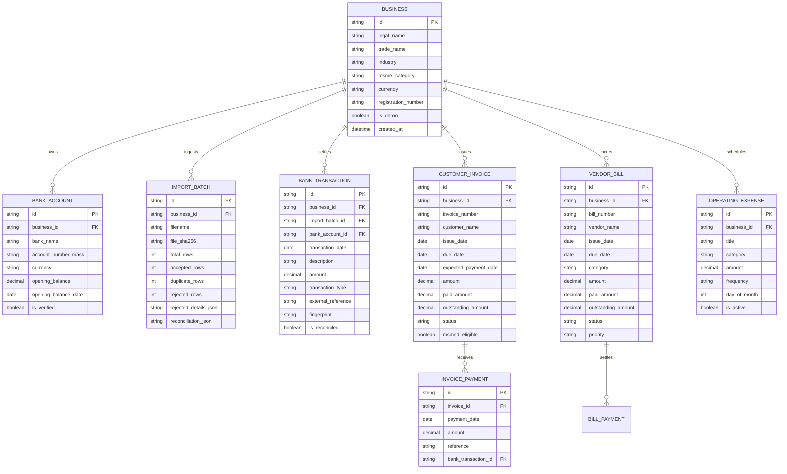

# KOSHA — Persistent Data Schema Specification

> **Storage Engine:** SQLite (`kosha.db`) via SQLAlchemy ORM  
> **Financial Precision:** `Numeric(15, 2, asdecimal=True)` with Python `Decimal` representation  
> **Multi-Tenant Design:** All financial records are scoped to `business_id`

---

## 1. Database Entity-Relationship Architecture

---

## 2. Table Specifications & Constraints

### 1. `businesses`
- `id` (VARCHAR(36), PK): UUID4 or persona slug.
- `legal_name` (VARCHAR(255), NOT NULL): Official registered business entity name.
- `trade_name` (VARCHAR(255), NOT NULL): Commercial brand name.
- `industry` (VARCHAR(100), NOT NULL): Industry vertical (e.g. `Automotive Ancillary`).
- `msme_category` (VARCHAR(20), NOT NULL): MSME Act classification (`Micro`, `Small`, `Medium`).
- `currency` (VARCHAR(10), DEFAULT `"INR"`): Functional currency.
- `is_demo` (BOOLEAN, DEFAULT `FALSE`): Strictly isolates synthetic demonstration records from real financial databases.

### 2. `bank_accounts`
- `id` (VARCHAR(36), PK)
- `business_id` (VARCHAR(36), FK -> `businesses.id`, INDEX)
- `bank_name` (VARCHAR(100), NOT NULL)
- `opening_balance` (NUMERIC(15, 2), NOT NULL, DEFAULT 0.00): Base liquid capital.
- `opening_balance_date` (DATE, NOT NULL): The statement date from which the balance is verified.
- `is_verified` (BOOLEAN, DEFAULT `FALSE`): Verified against a physical or exported bank statement.

### 3. `import_batches`
- `id` (VARCHAR(36), PK)
- `business_id` (VARCHAR(36), FK -> `businesses.id`, INDEX)
- `file_sha256` (VARCHAR(64), NOT NULL, INDEX): Cryptographic hash preventing accidental re-upload of identical files.
- `accepted_rows` (INTEGER, NOT NULL)
- `duplicate_rows` (INTEGER, NOT NULL)
- `rejected_rows` (INTEGER, NOT NULL)
- `rejected_details_json` (TEXT): Audit trail of unparseable rows with specific row numbers and error descriptions.
- `reconciliation_json` (TEXT): Summary of credits, debits, and verified net liquidity movement.

### 4. `bank_transactions`
- `id` (VARCHAR(36), PK)
- `business_id` (VARCHAR(36), FK -> `businesses.id`, INDEX)
- `transaction_date` (DATE, NOT NULL, INDEX)
- `description` (TEXT, NOT NULL)
- `amount` (NUMERIC(15, 2), NOT NULL): Unsigned monetary value.
- `transaction_type` (VARCHAR(10), NOT NULL): Either `"credit"` (inflow) or `"debit"` (outflow).
- `external_reference` (VARCHAR(100), NULLABLE): Bank UTR, cheque number, or gateway ID.
- `fingerprint` (VARCHAR(64), NOT NULL, INDEX): Hash of `(date, amount, type, description, external_ref)` preventing duplicate row insertion across batches.

### 5. `customer_invoices` & `invoice_payments`
- `customer_invoices.outstanding_amount = amount - paid_amount`
- Status transitions:
  - `unpaid`: `paid_amount == 0`
  - `partially_paid`: `0 < paid_amount < amount`
  - `paid`: `paid_amount == amount`
- **Validation Invariant:** A payment cannot exceed `outstanding_amount`. Attempted overpayments raise `ValidationError`.

### 6. `operating_expenses`
- Represents recurring contractual commitments (rent, payroll, utility contracts, statutory advance tax).
- `frequency`: `"monthly"`, `"quarterly"`, or `"annual"`.
- `day_of_month`: Specified payment anchor (e.g. 7th for TDS, 20th for GSTR-3B, 1st for factory rent).
- The 90-day simulator projects these dates across the forward horizon dynamically.
