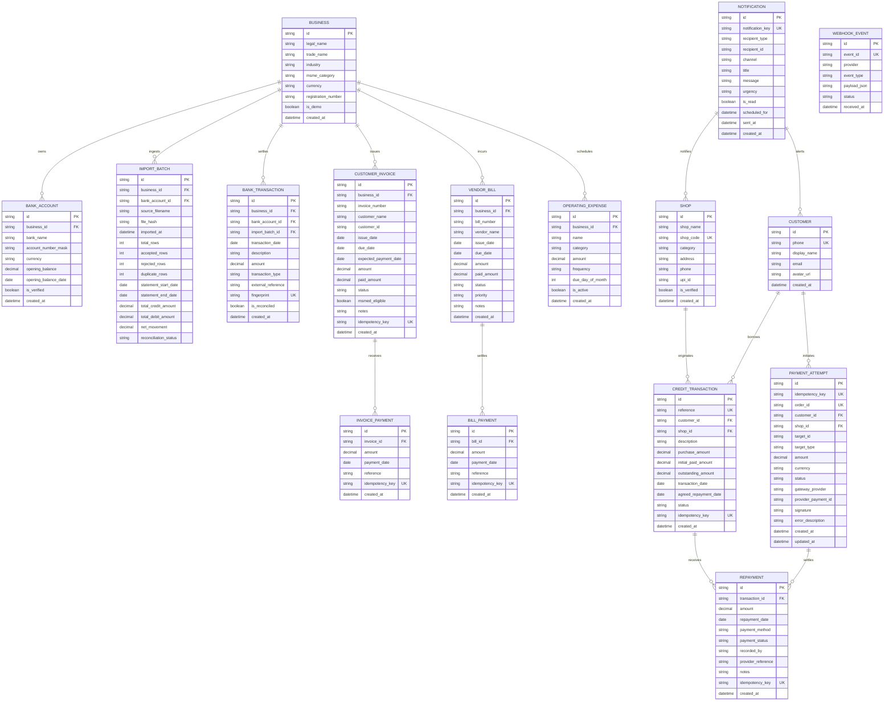

# KOSHA — Persistent Data Schema Specification

> **Storage Engine:** SQLite (`kosha.db`) via SQLAlchemy 2.0 ORM  
> **Financial Precision:** `Numeric(15, 2, asdecimal=True)` with Python `Decimal` representation  
> **Multi-Tenant Design:** All financial records are scoped to `business_id` or `customer_id`  
> **Idempotency & Integrity:** Cryptographic SHA-256 batch hashes, transaction fingerprints, and deterministic idempotency keys

---

## 1. Database Entity-Relationship Architecture

---

## 2. Integrity & Deduplication Rules

1. **Bank Statement CSV Ingestion:**
   - Entire file cryptographic SHA-256 hash evaluated against `import_batches.file_hash`. Re-uploading an identical file returns HTTP `409 Conflict` with `DUPLICATE_FILE_IMPORT`.
   - In-file duplicate rows with external references are filtered into `exact_file_duplicates`.
   - Existing transactions in the database are filtered into `previously_imported_duplicates`.
   - Repeated same-day same-amount transactions without external reference (common in MSME petty cash and tea/fuel expenses) are preserved using occurrence-based discriminator hashes (`potential_duplicates_review`).

2. **Customer & Merchant Ledgers:**
   - Invoices and Bills enforce unique document numbers per business.
   - Payments and Credit Transactions support client-supplied `idempotency_key`s. Duplicate submissions return the identical existing record without double-debiting balances.
   - Overpayment protection is strictly enforced at database service level. Attempting to repay more than the current outstanding amount raises HTTP `422/400 OVERPAYMENT_NOT_ALLOWED`.

3. **Payment Gateways & Webhooks:**
   - Webhook retries are deduped via SQLite unique index on `webhook_events.event_id`.
   - Payment orders are recorded in `payment_attempts` with status transitions (`created` -> `succeeded` / `failed` / `refunded`).

4. **Persistent Notifications & Reminders:**
   - Notifications use deterministic keys formatted as `remind:{type}:{id}:{tx_id}:{date}:{urgency}`.
   - Running reminder evaluation multiple times on the same date produces 0 duplicate notifications.
   - Due dates and urgencies evaluate strictly in `Asia/Kolkata` timezone.
