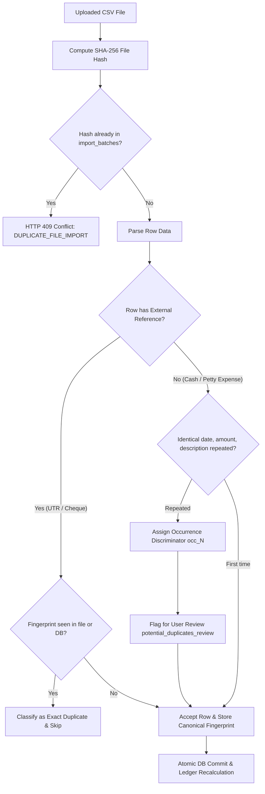

# KOSHA — Integrations, Real-Data Boundaries & Sandbox Architecture

> **Document Status:** Authoritative Integration Guide for Srujana Tech Fest 2026  
> **Team:** Halfwave  
> **Core Principle:** Transparent separation of verified persistent data from sandbox simulations. No fabricated bank connections, fake payment transfers, or hardcoded mock dashboards.

---

## 1. Architectural Boundaries: Real vs Simulated

In accordance with ethical fintech software engineering principles, KOSHA maintains a strict separation between real persistent data, sandbox simulations, and synthetic demonstration datasets.

| Dimension | Real / Persistent Implementation | Sandbox Simulation Boundary | Synthetic Demonstration Datasets |
|---|---|---|---|
| **Treasury & Bank Ledgers** | Reconciled SQLite database (`kosha.db`) stores real user CSV uploads, accounts, transactions, and balances. | N/A | Pre-seeded baseline MSME profiles (Apex Precision, Lakshmi Provisions, City Hardware) used for instant evaluation. |
| **Accounts Receivable & Invoicing** | Real persistent invoices, bills, payments, and MSMED Section 16 penal interest calculations. | N/A | Pre-seeded realistic overdue receivables with variable ageing (15–90 days). |
| **Digital Payments & UPI** | SQLite `PaymentAttemptModel` & `WebhookEventModel` maintain auditable order states and idempotency. | Provider abstraction operates in **KOSHA Sandbox** when external credentials are absent. Generates demo orders and mock UPI flows. | N/A |
| **QR Code Verification** | Real SVG QR code generation (`qrcode` library) encoding `kosha://shop/{shop_code}` with real camera scanning via `Html5Qrcode`. | Non-sensitive payload (never contains passwords, account numbers, or balances). | Demo shop QR codes for Apex, Lakshmi, and City Hardware. |
| **Scheduled Reminders** | Persistent SQLite `NotificationModel` with deterministic unique keys preventing duplicate alerts. Evaluated strictly in `Asia/Kolkata`. | In-app delivery and API evaluation simulate automated daily cron execution. | N/A |

---

## 2. Payment Gateway Integration Boundary

### 2.1 Provider-Neutral Abstraction
The backend implements a provider-neutral boundary: [`PaymentGatewayService`](file:///c:/Hackathon Projects/Kosha/backend/app/services/payment_gateway.py).

When environment variables `PAYMENT_GATEWAY_KEY_ID` and `PAYMENT_GATEWAY_KEY_SECRET` are not configured, the service operates in **KOSHA Sandbox Simulation Mode**:
- `is_sandbox: true` is explicitly communicated to the frontend and displayed in the UI.
- Simulated orders (`ORDER_SANDBOX_...`) and payment IDs (`PAY_SANDBOX_...`) are generated.
- Completing a sandbox repayment records an auditable repayment record in SQLite without contacting external payment rails.

### 2.2 Production Gateway Readiness
To connect a live payment gateway (e.g., Razorpay or Cashfree):
1. Set the following environment variables in `.env`:
   ```bash
   PAYMENT_GATEWAY_PROVIDER=RAZORPAY
   PAYMENT_GATEWAY_KEY_ID=rzp_live_your_key_id
   PAYMENT_GATEWAY_KEY_SECRET=your_live_key_secret
   PAYMENT_GATEWAY_WEBHOOK_SECRET=your_webhook_signing_secret
   ```
2. The service dynamically switches `is_sandbox: false` and validates HMAC SHA-256 signatures on callbacks and webhooks.

### 2.3 Security & Regulatory Constraints
1. **Zero Credential Storage:** KOSHA **never** collects, processes, or stores UPI PINs, net banking passwords, CVVs, or OTPs. All sensitive authentication is delegated to bank/gateway client interfaces.
2. **Transparent Labeling:** Sandbox mode is prominently labeled to prevent users from believing real money has moved.
3. **Idempotent Webhooks:** Webhook callbacks are deduped by storing `event_id` in the `webhook_events` table with a database unique index. Duplicate webhook retries are acknowledged with HTTP 200 `status: "ignored"` without double-crediting balances.

---

## 3. Bank Statement CSV Ingestion & Deduplication

### 3.1 Sniffing & Robust Parsing
The CSV parser ([`csv_importer.py`](file:///c:/Hackathon Projects/Kosha/backend/app/domain/csv_importer.py)) handles heterogeneous Indian bank statements:
- **Encoding Sniffing:** Supports UTF-8, Latin-1, CP1252, and UTF-8 with BOM.
- **Delimiter Sniffing:** Automatically detects commas (`,`), semicolons (`;`), and tabs (`\t`).
- **Flexible Column Mapping:** Automatically recognizes English and standard banking header variants (`Date`, `Txn Date`, `Value Date`, `Description`, `Particulars`, `Narration`, `Withdrawal`, `Deposit`, `Credit`, `Debit`, `Chq / Ref No`, `UTR`).

### 3.2 Deduplication Pipeline


### 3.3 Preserving Legitimate Repeated Transactions
Small Indian MSMEs regularly record multiple identical cash transactions on the same day (e.g., two ₹500 tea/refreshment expenses or multiple ₹100 auto-rickshaw fares without UTR numbers). Discarding these would cause closing cash balances to diverge from bank balances.

KOSHA solves this by preserving legitimate repeated same-day entries using occurrence-based discriminator hashes while surfacing them in `potential_duplicates_review` for transparent audit.

---

## 4. Persistent Reminder & Notification Service

### 4.1 Timezone Boundary
All financial dates and repayment deadlines are evaluated strictly in **`Asia/Kolkata`** (`ZoneInfo("Asia/Kolkata")`), ensuring that reminder triggers, due date transitions, and interest calculations match Indian Standard Time (IST) business days.

### 4.2 Deterministic Notification Keys
To guarantee that scheduled background jobs or repeated user visits never generate duplicate notification banners, every notification key is computed deterministically:
```
remind:cust:{customer_id}:{transaction_id}:{YYYY-MM-DD}:{urgency}
remind:shop:{shop_id}:{transaction_id}:{YYYY-MM-DD}:overdue
```
Repeated evaluations on the same calendar day detect the existing key in the SQLite `notifications` table and increment `skipped_duplicates_count` without inserting redundant rows.

---

## 5. Idempotent API Contracts

All financial mutating endpoints accept an optional or generated `idempotency_key`:
- `POST /api/invoices/{id}/payments`: Key ensures double-clicking "Record Payment" does not double-decrement the invoice balance.
- `POST /api/bills/{id}/payments`: Key prevents double-recording vendor disbursements.
- `POST /api/customer/credit-transactions`: Key prevents double-creating purchases if a network retry occurs.
- `POST /api/customer/repayments`: Key guarantees atomic repayment application.
- `POST /api/payment-gateway/initiate`: Key returns the existing pending order attempt if retried.
